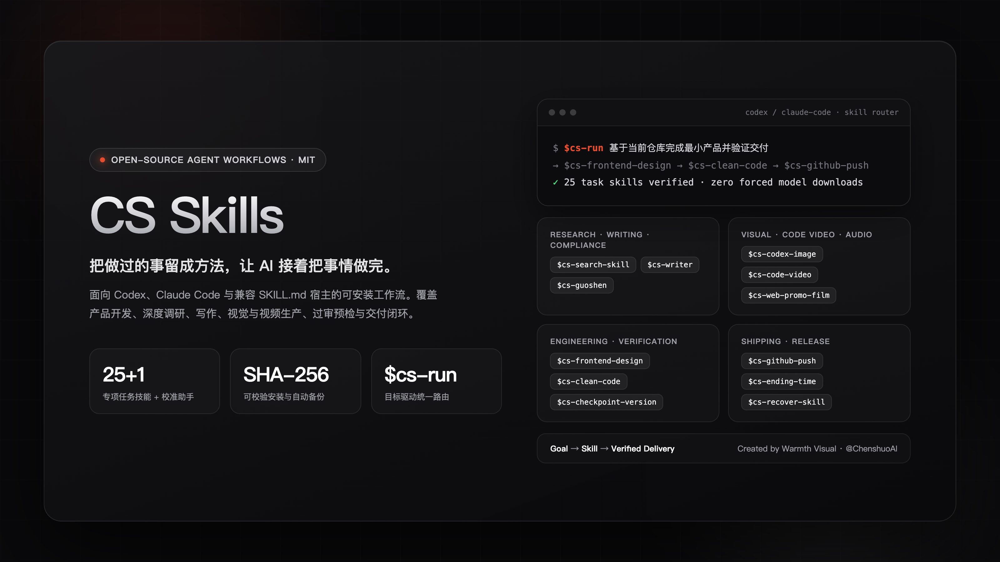
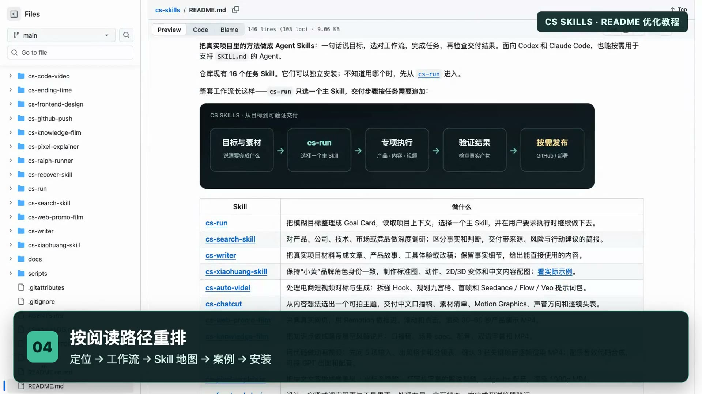
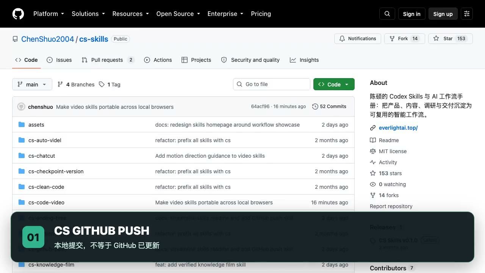

<div align="center">

# CS Skills

**Keep the method. Let your agent carry it forward.**

Reusable agent workflows distilled from real **product engineering, research, writing, visual design, code-driven video, and delivery** projects by Chen Shuo (KAI).  
Install **25 task skills + 1 execution helper** into **Codex, Claude Code**, or any `SKILL.md`-compatible agent in one command.

[](README.md)
[](README.en.md)

[](https://github.com/ChenShuo2004/cs-skills/releases/latest)
[](https://github.com/ChenShuo2004/cs-skills/stargazers)
[](LICENSE)
[](https://x.com/ChenshuoAI)
[](https://page.aiyouwendu.com/en/products/cs-skills/)

[Install & Update](#install-or-update) · [Highlights](#why-cs-skills) · [Skill Directory](#choose-a-workflow) · [Demos](#real-demos) · [Models & Verification](#models-and-verification) · [FAQ](#faq)

</div>

<br/>

<div align="center">
  
  <p>
    <sub>
      🧭 <b>CS Skills Architecture</b>: <code>main</code> includes <b>25 task skills + 1 optional execution helper</b>; latest packaged release: <a href="https://github.com/ChenShuo2004/cs-skills/releases/tag/v0.7.0"><b>v0.7.0</b></a> (22 task skills)
    </sub>
  </p>
</div>

## Real Demos

| 🎬 01 · README Optimization Walkthrough | 🚀 02 · Verified GitHub Push |
| --- | --- |
| [](assets/demos/readme-optimization/demo-v2.mp4)<br/><sub>Audit repo capabilities → rewrite with `cs-writer` → verify commands with `cs-clean-code` · [Watch MP4](assets/demos/readme-optimization/demo-v2.mp4)</sub> | [](assets/demos/cs-github-push-demo.mp4)<br/><sub>Scoped commits, remote push, and SHA verification with `$cs-github-push` · [Watch MP4](assets/demos/cs-github-push-demo.mp4)</sub> |

## Why CS Skills?

- **Verifiable workflows, not loose prompts**: Every skill encodes what to inspect first, when to keep moving, and what counts as verified delivery.
- **Safe, SHA-256 verified cross-platform installer**: Identical files are skipped, changed directories are backed up to `.cs-skills-backups/`, and no models or runtimes are downloaded automatically.
- **Full-stack coverage**: Product engineering, source-backed research, grounded writing, KAI/Xiaohuang visuals, code-driven videos, `$cs-codex-image` Claude MCP bridge, and `$cs-guoshen` pre-publication risk review.

---

## Install or Update

Node.js 22+ on Windows, macOS, or Linux:

```sh
git clone https://github.com/ChenShuo2004/cs-skills.git
cd cs-skills
node scripts/install-skills.mjs
node scripts/install-skills.mjs --check
```

For an existing clone, run `git pull --ff-only`, then:

```sh
node scripts/install-skills.mjs --update
node scripts/install-skills.mjs --check
```

Select a subset or install into Claude Code / another `SKILL.md` host:

```sh
node scripts/install-skills.mjs --update cs-run cs-writer
node scripts/install-skills.mjs --target "$HOME/.claude/skills" --update
node scripts/install-skills.mjs --dry-run
```

> [!TIP]
> - The Bash symlink installer (`./scripts/install.sh --codex`, `--claude`, or `--both`) remains available and preserves existing directories and foreign links. On Windows without symlink privileges, use the Node installer above.
> - Open a **new Agent session** after installation and confirm the skills are listed. File consistency alone does not prove session discovery.

---

## Choose a Workflow

Use `$cs-run` for unclear or multi-stage goals, or invoke a specific skill directly.

| Skill | Purpose |
| --- | --- |
| [cs-run](cs-run/SKILL.md) | Task routing |
| [cs-writer](cs-writer/SKILL.md) | Chinese writing and revision |
| [cs-search-skill](cs-search-skill/SKILL.md) | Source-backed research |
| [cs-guoshen](cs-guoshen/SKILL.md) | Pre-publication draft/video risk review, evidence locators and minimal edits |
| [cs-video-download](cs-video-download/SKILL.md) | Download and verify videos in ~/Downloads/Videdown, with source records |
| [cs-codex-image](cs-codex-image/SKILL.md) | Codex built-in image generation/editing and a local Claude MCP bridge |
| [cs-kai-cover](cs-kai-cover/SKILL.md) | KAI article covers |
| [cs-xiaohuang-skill](cs-xiaohuang-skill/SKILL.md) | Xiaohuang IP and article illustrations |
| [cs-personal-ip-script](cs-personal-ip-script/SKILL.md) | Personal project narration |
| [cs-chatcut-video-blueprint](cs-chatcut-video-blueprint/SKILL.md) | Scripts, storyboards and image prompts |
| [cs-chatcut](cs-chatcut/SKILL.md) | ChatCut onboarding and planning |
| [cs-auto-videl](cs-auto-videl/SKILL.md) | Ecommerce reference and generation packages |
| [cs-code-story-video](cs-code-story-video/SKILL.md) | Narration-driven Remotion story videos |
| [cs-code-video](cs-code-video/SKILL.md) | Code animation and Vibe science videos |
| [cs-web-promo-film](cs-web-promo-film/SKILL.md) | Real webpage product demos |
| [cs-knowledge-film](cs-knowledge-film/SKILL.md) | Fixed night-sky explainer series |
| [cs-pixel-explainer](cs-pixel-explainer/SKILL.md) | Fixed pixel explainer series |
| [cs-digital-human-product-video-pipeline](cs-digital-human-product-video-pipeline/SKILL.md) | Digital-human product videos |
| [cs-narration-phrase-timeline](cs-narration-phrase-timeline/SKILL.md) | Real-audio phrase alignment |
| [cs-frontend-design](cs-frontend-design/SKILL.md) | Frontend design and implementation |
| [cs-clean-code](cs-clean-code/SKILL.md) | Code and documentation cleanup |
| [cs-ralph-runner](cs-ralph-runner/SKILL.md) | Ralph PRD execution |
| [cs-checkpoint-version](cs-checkpoint-version/SKILL.md) | Recoverable checkpoints |
| [cs-github-push](cs-github-push/SKILL.md) | Scoped GitHub delivery |
| [cs-ending-time](cs-ending-time/SKILL.md) | Validation and release or app deployment |

> [cs-recover-skill](cs-recover-skill/SKILL.md) is an optional execution helper, included in the archive and installed only when explicitly named.

### Recent Highlights on `main`

<details>
<summary><b>1. Codex built-in images in Claude (<code>cs-codex-image</code>)</b></summary>

```bash
node scripts/install-skills.mjs --target "$HOME/.claude/skills" --update cs-codex-image
node cs-codex-image/scripts/install.mjs --target both
node cs-codex-image/scripts/install.mjs --target both --check
```

Use `$cs-codex-image` in a new Claude session. The bridge uses the existing ChatGPT/Codex login without an API key (desktop config currently supports macOS). See [setup and recovery](cs-codex-image/references/setup.md).

</details>

<details>
<summary><b>2. Pre-publication risk review (<code>cs-guoshen</code>)</b></summary>

`cs-guoshen` adapts [huangbai-AI/guoshen](https://github.com/huangbai-AI/guoshen) under MIT, preserving upstream attribution and rule verification dates. It adds draft review, a local preparation CLI, revision checks, and edit handoff. Candidate scans never guarantee platform approval. See [usage and dependencies](cs-guoshen/references/workflow.md).

</details>

---

## Models and Verification

Most skills use the host Agent model without a fixed model name. Optional WhisperX Chinese alignment uses pinned files in [models/registry.json](models/registry.json) (see [dependency notes](docs/model-dependencies.md)):

```sh
python scripts/models.py check --profile whisperx-zh
# Only when this backend is selected and files are missing:
python -m pip install -r models/requirements.txt
python scripts/models.py download --profile whisperx-zh
```

Checks are read-only and offline; valid caches are reused and damaged files require `--repair`.

```sh
node scripts/validate-skills.mjs
python -m pip install -r cs-guoshen/requirements-dev.txt
node scripts/run-regression.mjs
python scripts/package-release.py
```

The regression runner needs Node.js 22+ and Python 3.12+ (`CS_SKILLS_PYTHON` selects the interpreter). Structural, script, and file checks do not prove fresh-session model behavior or final media quality.

---

## FAQ

<details>
<summary><b>1. Will updating overwrite my local skill customizations?</b></summary>

No silent overwrites. Changed directories are backed up to `.cs-skills-backups/` before replacement and verified with SHA-256.

</details>

<details>
<summary><b>2. Does installing skills download models or incur charges?</b></summary>

No. The installer only copies skill files. Optional external APIs or local models (such as WhisperX) are used only when you run those specific workflows.

</details>

---

## License

[MIT License](LICENSE) · [Changelog](CHANGELOG.md) · [Contributors](CONTRIBUTORS.md) · [Warmth Visual Product Page](https://page.aiyouwendu.com/en/products/cs-skills/) · [Chinese README](README.md)

<div align="center">

[](https://star-history.com/#ChenShuo2004/cs-skills&Date)

</div>
