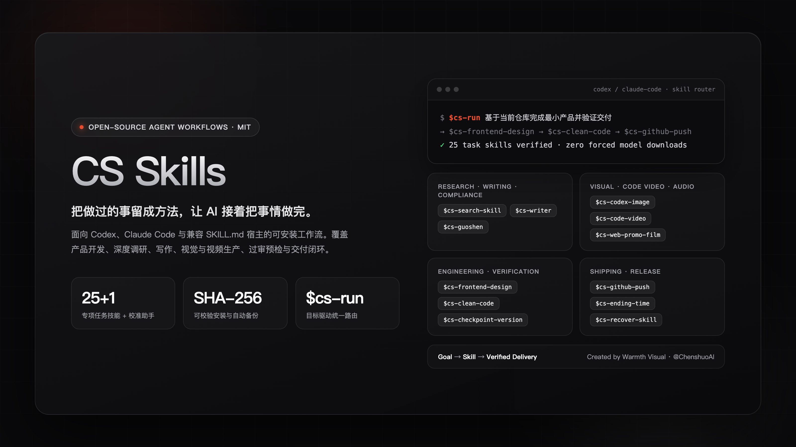
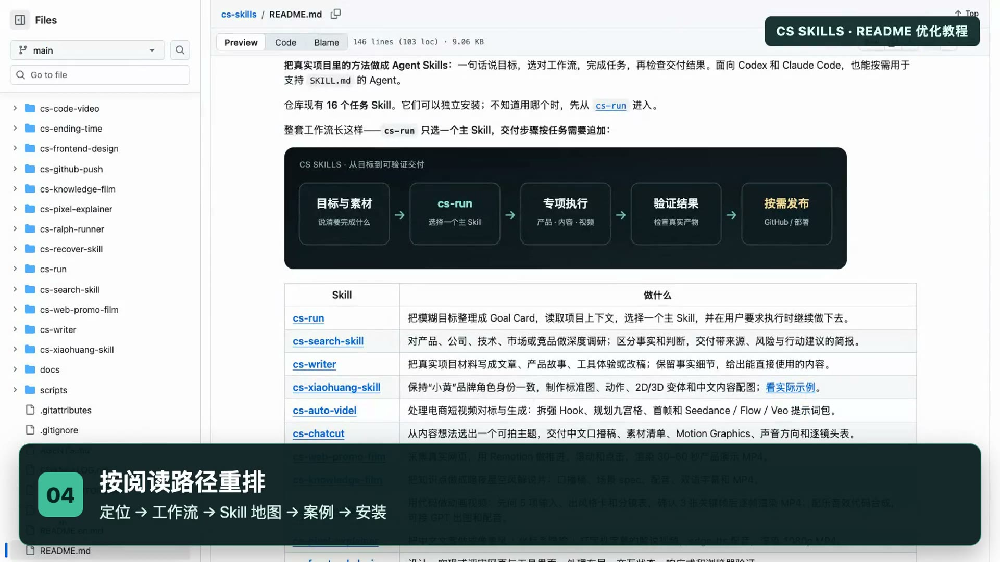
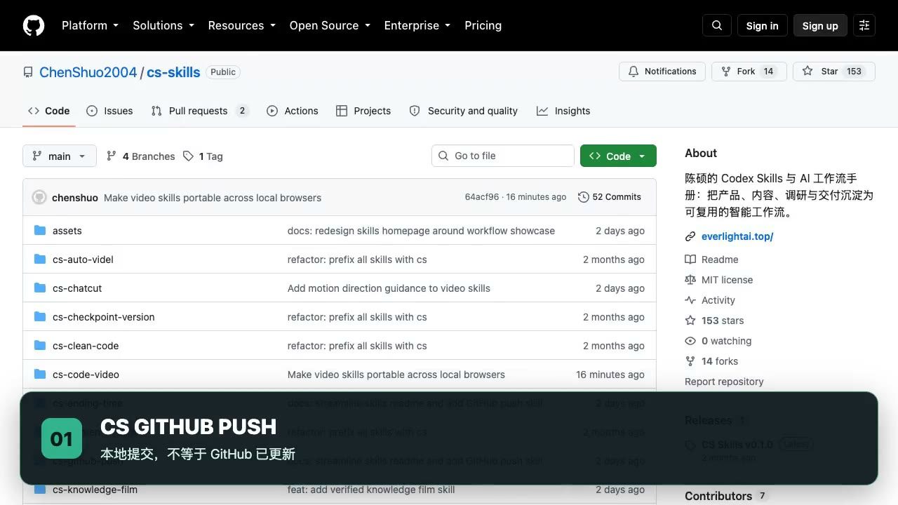

<div align="center">

# CS Skills

**把做过的事留成方法，让 AI 接着把事情做完。**

把陈硕（KAI）在真实项目中沉淀的 **产品开发、深度调研、内容写作、IP 配图、代码视频与发布交付** 经验，整理为 **25 个任务技能 + 1 个执行辅助技能**。  
带着目标、仓库或素材来，一条命令安装到 **Codex / Claude Code** 或其他支持 `SKILL.md` 的 Agent，直接复用可验证的交付工作流。

[](README.md)
[](README.en.md)

[](https://github.com/ChenShuo2004/cs-skills/releases/latest)
[](https://github.com/ChenShuo2004/cs-skills/stargazers)
[](LICENSE)
[](https://x.com/ChenshuoAI)
[](https://page.aiyouwendu.com/products/cs-skills/)

[安装与更新](#安装与更新) · [核心亮点](#核心亮点) · [按目标选技能](#按目标选技能) · [直接复制使用](#直接复制使用) · [真实演示](#真实演示) · [模型与依赖](#模型与依赖) · [常见问题](#常见问题)

</div>

<br/>

<div align="center">
  
  <p>
    <sub>
      🧭 <b>CS Skills 工作流全景</b>：当前 <code>main</code> 包含 <b>25 个任务技能 + 1 个执行辅助技能</b>；最新完整发布包为 <a href="https://github.com/ChenShuo2004/cs-skills/releases/tag/v0.7.0"><b>v0.7.0</b></a>（22 个任务技能）
    </sub>
  </p>
</div>

### 真实过程演示（点击封面看 1080p 演示成片）

| 🎬 01 · README 专项优化讲解 | 🚀 02 · GitHub 精确提交与远端核验 |
| --- | --- |
| [](assets/demos/readme-optimization/demo-v2.mp4)<br/><sub>检查仓库实际能力 → `cs-writer` 改写 → `cs-clean-code` 核对命令 · [观看 MP4](assets/demos/readme-optimization/demo-v2.mp4) · [口播与复现](assets/demos/readme-optimization/VO.md)</sub> | [](assets/demos/cs-github-push-demo.mp4)<br/><sub>用 `$cs-github-push` 精确提交、推送并校验远端 SHA · [观看 MP4](assets/demos/cs-github-push-demo.mp4) · [口播与分镜](assets/demos/cs-github-push-script.md)</sub> |

## 核心亮点

- **不止是提示词，而是可验收的工程与内容工作流**：每个技能都明确「先看哪些资料、什么时候继续、什么结果算完成」，从单一入口 `$cs-run` 到专项交付闭环。
- **跨平台可校验安装，安全备份不覆盖定制**：Node 安装器通用 Windows / macOS / Linux，内容一致自动跳过，有变化先备份到 `.cs-skills-backups/` 再核对 SHA-256，绝不自动下载大模型或运行库。
- **覆盖产品、写作、视觉、视频与发布前过审预检**：包含 `$cs-guoshen` 多平台过审风险预检、`$cs-codex-image` 将 Codex 内置生图以本地 MCP 接入 Claude Code，以及 [小黄 IP 与正文配图](cs-xiaohuang-skill/README.md) 等实战能力。

---

## 安装与更新

### 第一次安装（Node.js 22+，Windows / macOS / Linux 通用）

```powershell
git clone https://github.com/ChenShuo2004/cs-skills.git
cd cs-skills
node scripts/install-skills.mjs
node scripts/install-skills.mjs --check
```

### 已有本地仓库更新

```powershell
git pull --ff-only
node scripts/install-skills.mjs --update
node scripts/install-skills.mjs --check
```

默认将 25 个任务技能同步到 Codex 的技能目录。也可下载 [v0.7.0 完整安装包](https://github.com/ChenShuo2004/cs-skills/releases/download/v0.7.0/cs-skills-v0.7.0.zip) 解压后执行相同命令（[Release 页面](https://github.com/ChenShuo2004/cs-skills/releases/tag/v0.7.0)附包文件 SHA-256，包内 `INSTALL-MANIFEST.json` 记录全部文件哈希）。

### 按需挑选技能 / 安装到 Claude Code

```powershell
# 只安装需要的几个技能（先 --dry-run 预览）
node scripts/install-skills.mjs --update cs-run cs-writer cs-search-skill
node scripts/install-skills.mjs --dry-run

# 同步到 Claude Code 或其他支持 SKILL.md 的宿主目录
node scripts/install-skills.mjs --target "$HOME/.claude/skills" --update
```

> [!TIP]
> - 已有 Bash 环境也可继续使用 `./scripts/install.sh --codex`、`--claude` 或 `--both` 创建软链接随 `git pull` 更新（Windows 若无软链接权限请使用上面的 Node 安装器）。
> - **安装完成后请打开新会话检查技能列表**：Codex 总入口显示名为 `cs-skills`，调用名为 `$cs-run`；只装 `cs-run` 不会自动安装下游技能。

---

## 按目标选技能

知道要什么就直接调用对应技能；跨领域或还不清楚入口时用 `$cs-run`。名称与数量以 [注册表](tests/fixtures/skill-registry.json) 为准，详细边界见 [技能清单](docs/skill-inventory.md)。

| 你想完成什么 | 使用哪个 Skill | 交付什么 |
| --- | --- | --- |
| 从目标选择路径、串联多个阶段 | [$cs-run](cs-run/SKILL.md) | 匹配的工作流、产物与验证结果 |
| 预检稿件/成片发布风险、分析卡审与修改后复查 | [$cs-guoshen](cs-guoshen/SKILL.md) | 分平台依据、真实定位与最小修改清单 |
| 下载视频链接并统一归档 | [$cs-video-download](cs-video-download/SKILL.md) | 已验证 MP4 与来源记录，默认 ~/Downloads/Videdown |
| 写文章、项目复盘、X 帖子或改稿 | [$cs-writer](cs-writer/SKILL.md) | 保留真实事实和个人判断的成稿 |
| 调研产品、技术、市场与竞品 | [$cs-search-skill](cs-search-skill/SKILL.md) | 有来源的比较与决策简报 |
| 使用 Codex 内置生图，或接入 Claude | [$cs-codex-image](cs-codex-image/SKILL.md) | 真实 PNG、参考图编辑与可检查的本地 MCP |
| 做 KAI 固定角色的文章封面 | [$cs-kai-cover](cs-kai-cover/SKILL.md) | 标题清晰的 5:2 PNG 与无字背景 |
| 延展小黄 IP、给中文文章配图 | [$cs-xiaohuang-skill](cs-xiaohuang-skill/SKILL.md) | 角色资产、配图规划与正文插画 |
| 把真实项目写成个人 IP 口播 | [$cs-personal-ip-script](cs-personal-ip-script/SKILL.md) | 可录稿、独立演绎标注与事实待补项 |
| 写自媒体剧本、分镜和逐图提示词 | [$cs-chatcut-video-blueprint](cs-chatcut-video-blueprint/SKILL.md) | 完整制作文本包或点名补充项 |
| 了解 ChatCut 安装与制作操作 | [$cs-chatcut](cs-chatcut/SKILL.md) | 策划、上手指南与编辑工作台交接 |
| 做电商视频对标、九宫格和生成包 | [$cs-auto-videl](cs-auto-videl/SKILL.md) | 分镜图、首帧与平台生成提示词 |
| 用最终口播做角色 A/B-roll 叙事片 | [$cs-code-story-video](cs-code-story-video/SKILL.md) | Remotion 工程、样片、全片与双比例封面 |
| 制作代码动画、KAI 教程或 Vibe 科普 | [$cs-code-video](cs-code-video/SKILL.md) | 风格卡、分镜、样片与可重渲视频 |
| 把真实网页拍成产品演示宣传片 | [$cs-web-promo-film](cs-web-promo-film/SKILL.md) | 页面采集、Remotion 工程与 MP4 |
| 制作固定暗夜星空知识解说系列 | [$cs-knowledge-film](cs-knowledge-film/SKILL.md) | 场景 spec、配音、双语字幕与 MP4 |
| 制作固定像素解说系列 | [$cs-pixel-explainer](cs-pixel-explainer/SKILL.md) | 像素动画、实际配音、SRT 与 MP4 |
| 做数字人产品介绍视频 | [$cs-digital-human-product-video-pipeline](cs-digital-human-product-video-pipeline/SKILL.md) | 环境预检、可审批样片与成片 QA |
| 将最终录音与实际朗读稿对齐 | [$cs-narration-phrase-timeline](cs-narration-phrase-timeline/SKILL.md) | 词级边界、短语时间表与覆盖率 |
| 设计、实现或迭代产品页面 | [$cs-frontend-design](cs-frontend-design/SKILL.md) | 页面实现、交互与浏览器检查 |
| 定位问题、整理代码与同步文档 | [$cs-clean-code](cs-clean-code/SKILL.md) | 范围明确的修改与必要验证 |
| 把 Markdown 需求交给 Ralph 执行 | [$cs-ralph-runner](cs-ralph-runner/SKILL.md) | PRD、overview、构建结果与日志 |
| 大改前保存可恢复版本 | [$cs-checkpoint-version](cs-checkpoint-version/SKILL.md) | 本地 checkpoint 与恢复核对 |
| 提交、推送、开 PR 或核验 GitHub | [$cs-github-push](cs-github-push/SKILL.md) | 精确提交、远端 SHA 与按需 PR |
| 完成验证、发布或应用部署收尾 | [$cs-ending-time](cs-ending-time/SKILL.md) | 验证记录与已授权的实际交付 |

> [$cs-recover-skill](cs-recover-skill/SKILL.md) 为执行校准辅助入口：陷入反复验证或范围失控时复位执行。它保留在安装包中，默认不安装，需要时显式指定名称即可。

---

## 直接复制使用

**做产品：**

```text
$cs-run 基于这个仓库做一个能本地使用的最小产品。先完成核心流程，再检查桌面和手机上的交互，交付代码和验证结果。
```

**写内容，附封面与配图：**

```text
$cs-run 把下面的真实项目记录写成一篇文章，保留失败、过程和判断。完成后用 KAI 做 5:2 封面，用小黄规划正文配图；不要补造数据。
```

**做自媒体文本包：**

```text
$cs-run 用这段真实经历写一条 60–90 秒个人 IP 口播，并附逐镜分镜、每张图完整可复制的图片提示词和必要动作提示词。台词与制作备注分开，还没有录音，先交文本包。
```

**做原声叙事视频：**

```text
$cs-code-story-video 这里是最终口播音频、实际朗读稿和角色图。请制作 16:9 叙事视频，交付两章样片、完整版、可编辑工程和双比例封面。
```

**更新 README 并发布：**

```text
$cs-run 检查实际技能、路由和安装器，用 cs-writer 优化 README 的产品介绍，用 cs-clean-code 核对安装命令。先更新我的本地技能并校验一致，再更新 GitHub 默认分支和完整安装包。
```

### 近期新增重点技能（`main` 分支）

<details>
<summary><b>1. 在 Claude 使用 Codex 内置生图（<code>$cs-codex-image</code>）</b></summary>

```bash
node scripts/install-skills.mjs --target "$HOME/.claude/skills" --update cs-codex-image
node cs-codex-image/scripts/install.mjs --target both
node cs-codex-image/scripts/install.mjs --target both --check
```

打开新的 Claude 会话，调用 `$cs-codex-image` 出图。MCP 安装器会保留其他设置并备份变化，使用现有 ChatGPT/Codex 登录，不要求 API Key；桌面配置安装器当前支持 macOS。详见 [接入说明](cs-codex-image/references/setup.md)（v0.7.0 安装包尚未包含）。

</details>

<details>
<summary><b>2. 发布前多平台过审预检（<code>$cs-guoshen</code>）</b></summary>

`cs-guoshen` 基于 [huangbai-AI/guoshen](https://github.com/huangbai-AI/guoshen) 优化，保留 MIT 许可与原作者版权。新增稿件预检、统一证据包入口、成片复查及剪辑修改交接；缺轨和来源过期会进入报告，不承诺平台放行（v0.7.0 安装包尚未包含）。

```sh
node scripts/install-skills.mjs --update cs-guoshen
node scripts/install-skills.mjs --check cs-guoshen
```

```text
用 $cs-guoshen 检查这份 AI 教程稿在小红书和抖音的发布风险，保留核心观点，给我最小修改版。
```

详细命令与依赖见 [运行说明](cs-guoshen/references/workflow.md)。稿件只需 Python；视频需要 FFmpeg、本地 whisper.cpp 模型及 macOS OCR，安装不下载模型。

</details>

---

## 真实演示

- [README 优化讲解 MP4](assets/demos/readme-optimization/demo-v2.mp4) · [口播与复现说明](assets/demos/readme-optimization/VO.md)
- [GitHub 推送录屏 MP4](assets/demos/cs-github-push-demo.mp4) · [口播与分镜](assets/demos/cs-github-push-script.md)
- [小黄 IP 与正文配图展示](cs-xiaohuang-skill/README.md)

---

## 模型与依赖

**安装技能不会自动下载模型。** 写作、调研、代码和文本蓝图沿用宿主 Agent 的模型，没有统一绑定的聊天模型型号。

| 阶段 | 需要什么 |
| --- | --- |
| **写作、规划、开发与 Git 交付** | 宿主 Agent 和当前任务需要的搜索、浏览器或 CLI |
| **Codex 内置生图与 Claude 接入** | 支持内置图片工具的 Codex、ChatGPT 登录；MCP 桥接需 Node 22+ / npm |
| **KAI / 小黄图片与电商视频生成** | 已配置的图像工具或任务选择的云端服务 |
| **中文音频对齐（可选 WhisperX）** | 可选 Whisper large-v3 + 中文 wav2vec2，共约 4.37 GB |
| **代码视频渲染** | 对应 Node / Python、浏览器、Remotion 或 FFmpeg；渲染本身不需要生成模型 |
| **数字人与 TTS** | 实际 ComfyUI 工作流、Fish/TTS 配置或用户原声，按版本确认模型 |

[模型注册表](models/registry.json)记录固定版本、官方大小与哈希，[依赖说明](docs/model-dependencies.md)提供缓存复用方法（Python 3.12+）：

```powershell
python scripts/models.py check --profile whisperx-zh

# 已选该后端且确有缺失时再运行
python -m pip install -r models/requirements.txt
python scripts/models.py download --profile whisperx-zh
```

检查只读、不联网；有效缓存直接复用，损坏文件须显式 `--repair`，已有目录可用 `--model-dir` 指定。

---

## 维护与验证

每个技能以 `SKILL.md` 为入口，Codex 展示配置在 `agents/openai.yaml`。新增入口时同步路由、注册表、模型依赖、两份 README 与相关行为案例。

```powershell
node scripts/validate-skills.mjs
python -m pip install -r cs-guoshen/requirements-dev.txt
node scripts/run-regression.mjs
node scripts/install-skills.mjs --check
python scripts/package-release.py
```

回归需要 Node.js 22+ 与 Python 3.12+（多版本 Python 可通过 `CS_SKILLS_PYTHON` 指定）；Bash 安装器检查为 `./scripts/test-install.sh`。结构与脚本通过不等于新会话模型行为已通过，[行为验收](docs/evals/README.md)单独记录。

---

## 常见问题

<details>
<summary><b>1. 安装技能会覆盖我本地改过的旧技能吗？</b></summary>

不会静默覆盖。普通安装遇到已有同名目录会保留并报告冲突；使用 `--update` 时，有变化的旧目录会先完整备份到目标技能目录下的 `.cs-skills-backups/`，再写入新版本并校验 SHA-256。

</details>

<details>
<summary><b>2. 只安装 <code>cs-run</code> 就能自动调用全部 25 个技能吗？</b></summary>

不能。`$cs-run` 负责按目标路由和串联阶段，但不会自动安装下游技能；如需全套能力，请运行 `node scripts/install-skills.mjs` 默认安装全部任务技能，或显式列出所需技能名。

</details>

<details>
<summary><b>3. Claude Code 或其他 Agent 可以使用吗？</b></summary>

可以。使用 `node scripts/install-skills.mjs --target "$HOME/.claude/skills" --update` 同步到目标目录即可复用工作流；具体工具、MCP 连接和模型权限以各自宿主环境为准。

</details>

---

## 致谢与许可证

[English](README.en.md) · [协作规则](AGENTS.md) · [更新日志](CHANGELOG.md) · [贡献者](CONTRIBUTORS.md) · [MIT License](LICENSE) · [有温度AI 产品页](https://page.aiyouwendu.com/products/cs-skills/) · [陈硕 KAI](https://everlightai.top)

<div align="center">

[](https://star-history.com/#ChenShuo2004/cs-skills&Date)

</div>
